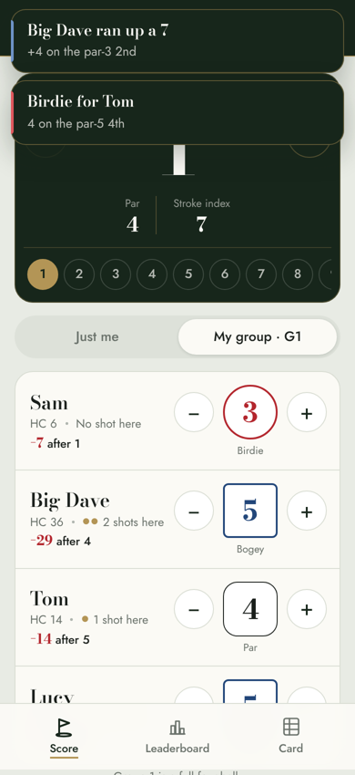

# Radar

A live golf scorecard and net leaderboard for a group. Everyone enters their own score on their phone after each hole, and every phone's leaderboard updates instantly.

## How it works

1. **Start a round:** pick or enter the course (par and stroke index for each hole) and add players with their playing handicaps.
2. **Share the code:** each round gets a 6-letter code and link. Friends open it, tap their name (or add themselves), and score.
3. **Score each hole:** tap the number for par, then − / +. Scores save automatically and appear on everyone's phone.

## Leaderboard

A "Leaders" board plus a hole-by-hole board in the style of classic tournament scoreboards: red numbers under par, green over. The Card tab is a full scorecard with a column per player (fits 3 or 4 on a phone) and gold dots where each player gets shots.

## Leaderboard modes

| Mode | How it scores |
|---|---|
| **Net** (default) | Everyone starts on minus their handicap (off 36 → −36, off 6 → −6). Each hole adds your gross score against par. |
| **Net by SI** | Handicap shots are taken hole by hole using the stroke index, so the board is fair mid-round. |
| **Stableford** | Points per hole using your shots (net par = 2, net birdie = 3…). |

All three finish on the same net result for stroke play. Plus handicaps are entered as `+2`.

## Alerts

In-app pop-ups (plus vibration) for birdies, eagles and aces, lead changes, big numbers (triple bogey or worse), and players finishing. Each can be switched off in ⚙︎.
Phone notifications can be enabled for when the app is in the background. On iPhone, first use **Share → Add to Home Screen** and open it from there.

## Tech

- Plain HTML/CSS/JS, no build step. Hosted on GitHub Pages.
- [Supabase](https://supabase.com) (free tier) for storage and realtime updates. The schema is in `supabase/schema.sql`.
- `scoring.js` holds all the handicap and leaderboard maths with no dependencies.

There's no sign-in: anyone with a round's code can view and score that round.
